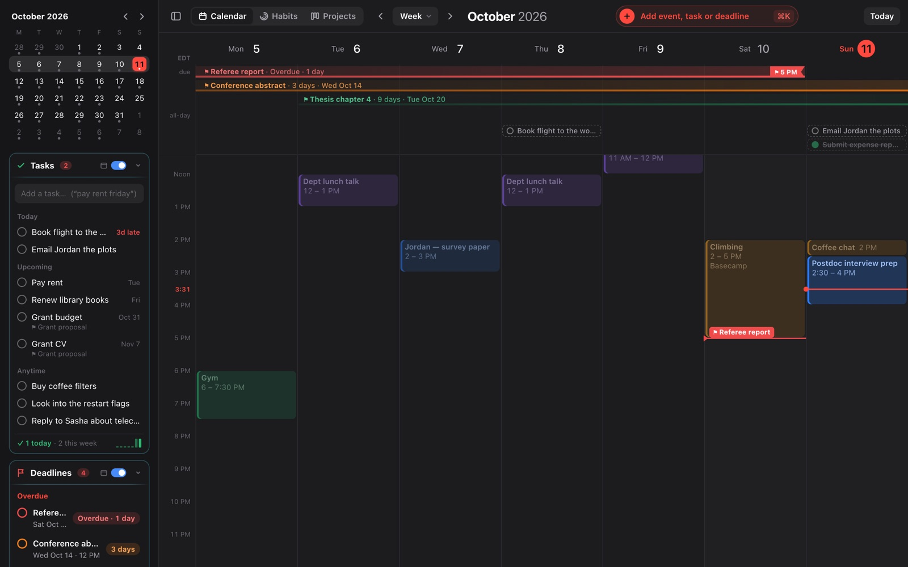

# Worldline

A calendar, habits and research-projects app for Mac and iPhone, synced between your devices end-to-end encrypted —
free, with no account and no server.

**[Download for Mac](https://github.com/BradenSeefeldt/worldline/releases/latest/download/Worldline.dmg)** ·
**[Open on iPhone](https://bradenseefeldt.github.io/worldline/app/)** ·
[Website](https://bradenseefeldt.github.io/worldline/)



macOS 11+ (Apple silicon and Intel) · iOS 16.4+ · 12 MB

**First launch on the Mac:**
1. Open the `.dmg` and drag **Worldline** onto **Applications**.
2. The first time you open it: **System Settings → Privacy & Security → Open Anyway** (once only; the app isn't
   signed with a paid Apple Developer ID).
3. Or skip both steps with Terminal: `curl -fsSL https://bradenseefeldt.github.io/worldline/install.sh | sh`

## What it does

- **Quick add** in plain English: “lunch with Sam tomorrow 12:30 #social for 90 min” — or “move Alex's meeting to tues at 3pm”.
- **Tasks and deadlines**, with runways that change colour as the due date gets close.
- **Habits** with strength, streaks and years of history.
- **Projects**: write-as-you-go pages and notes that gather your to-dos, ideas and who you're waiting on.
- **Scheduling links** (book a time, group polls) that work for anyone, with no accounts.
- **Calendar subscriptions** (any iCal link) and sync between your Mac and iPhone.

**Documentation:** [all docs](docs/README.md) · [Installing](docs/install.md) · [Using it](docs/using.md) ·
[Sync](docs/sync.md) · [Privacy](docs/privacy.md) · [Development](docs/development.md)

## Build from source

Needs Node.js 22+, Rust and Apple's command-line tools ([details](docs/install.md#the-mac-app)).

```bash
cd web
npm install
npm run app:package
```

License: MIT
